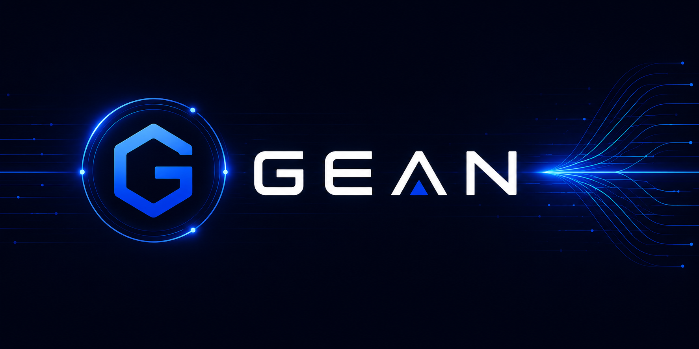

# Gean: Lean Ethereum consensus client

An open-source Lean Ethereum consensus client, written in Go and maintained by Gean Labs.



## Overview

Gean is:

- A consensus client for [Lean Ethereum](https://github.com/leanEthereum), designed for fast finality, quantum-resistant security, and a simpler core protocol.
- Implementing Lean Consensus devnet-5 alongside independent client implementations.
- Built for clarity and auditability, with a deliberately small codebase.
- Quantum-resistant by design, using XMSS signatures instead of BLS signatures.

## Getting started

### Prerequisites

- [Go](https://go.dev/doc/install) 1.26+
- [Rust](https://www.rust-lang.org/tools/install) 1.92.0
- [uv](https://docs.astral.sh/uv/)
- [Docker](https://www.docker.com/get-started/)

### Building and testing

```sh
make build       # Build the Rust FFI and Go binaries
make test        # Run Go unit tests
make test-ffi    # Run XMSS FFI tests
make test-spec   # Generate and run production-scheme consensus fixtures
make lint        # Run Go and Rust linters
make docker-build
```

Run `make help` for all available targets.

### Running locally

For a multi-client devnet:

```sh
make run-devnet
```

For a three-node Gean network, run the setup once and start each node in a separate terminal:

```sh
make run-setup
make run
make run-node1
make run-node2
```

At least one node must run as an aggregator for the network to finalize.

### Memory requirements

Block-proposal and aggregation proofs are generated by the XMSS prover, which
adds a transient multi-gigabyte peak per proof. By default gean proves on the
system allocator, so that scratch is freed after each proof and a long-lived
node's memory stays bounded — this is the mode for packing many nodes onto one
host (interop devnets). `--prover-arena` instead proves on leanVM's bump arena:
faster, but the arena never returns pages, so RSS ratchets to the allocation
high-water mark (~12 GB) and stays there — use it only on a host with memory to
spare where proving latency is the constraint.

Either way, a proof's transient peak is multi-gigabyte; tighter container limits
get the process OOM-killed mid-proving, which is silent in the application log
(check `docker inspect` for `OOMKilled` or the kernel log). The image sets
`GOMEMLIMIT=2GiB` to keep the Go heap out of the prover's headroom; override it
via the environment if your budget differs.

## Current status

Gean tracks Lean Consensus devnet-5. Consensus fixtures are generated from
`leanSpec@eca701efeb5931010fe63925cd203c9ee55b2dbc`, which pins
`lean-multisig-py` v0.0.9. The XMSS FFI builds against
leanVM `e2592df4e30fdddbbf8ae26a333116c68cec7026`.

`LEAN_SPEC_COMMIT_HASH` in the [`Makefile`](Makefile) is the source of truth for
the spec version; the leanVM rev is pinned in
[`xmss/rust/multisig-glue/Cargo.toml`](xmss/rust/multisig-glue/Cargo.toml).

## Architecture overview

Gean is a single Go module. Consensus logic lives in `internal/`, and XMSS signatures and proofs are Go bindings over Rust FFI crates in `xmss/`.

| Package | Description |
| --- | --- |
| **Binaries** | |
| [`cmd/gean`](cmd/gean) | Node binary: flags, bootstrap, servers, and shutdown |
| [`cmd/keygen`](cmd/keygen) | Testnet configuration and XMSS key generation |
| **Node** | |
| [`internal/node`](internal/node) | Engine: single dispatch loop, tick-driven duties, gossip handling, and workers |
| [`internal/dutygate`](internal/dutygate) | Suspends duties while the node lags sync or the network stalls |
| [`internal/role`](internal/role) | Runtime aggregator role toggle |
| **Consensus** | |
| [`internal/types`](internal/types) | Consensus containers and generated SSZ encoding |
| [`internal/genesis`](internal/genesis) | Genesis config, validators, and state |
| [`internal/statetransition`](internal/statetransition) | leanSpec state transition: slots, blocks, justification, and finality |
| [`internal/forkchoice`](internal/forkchoice) | Proto-array LMD-GHOST, votes, and safe target |
| **Blocks and attestations** | |
| [`internal/blockprocessor`](internal/blockprocessor) | Block validation, verification, transition, and persistence |
| [`internal/blockbuilder`](internal/blockbuilder) | Block proposal: payload selection and planning |
| [`internal/attestation`](internal/attestation) | Attestation production, validation, and signature verification |
| [`internal/attestationproof`](internal/attestationproof) | Selection and merging of attestation proofs |
| [`internal/aggregation`](internal/aggregation) | Signature aggregation into XMSS proofs |
| [`internal/proving`](internal/proving) | Proving gate shared by proposal and aggregation |
| [`internal/shadow`](internal/shadow) | Prover cost model for the Shadow network simulator |
| **Storage** | |
| [`internal/store`](internal/store) | Consensus store: blocks, states, gossip buffers, and pruning |
| [`internal/storage`](internal/storage) | Key-value backends: Pebble, and in-memory for tests |
| **Networking and sync** | |
| [`internal/p2p`](internal/p2p) | libp2p host, gossipsub, req/resp, ENR, and peer dialing |
| [`internal/syncer`](internal/syncer) | Range sync from peers ahead of the local head |
| [`internal/pending`](internal/pending) | Buffers for blocks and attestations awaiting unknown parents |
| [`internal/checkpoint`](internal/checkpoint) | Checkpoint sync: fetch and verify an anchor state and block |
| **Interfaces and observability** | |
| [`internal/api`](internal/api) | HTTP API, admin routes, metrics, pprof, and the Hive test driver |
| [`internal/metrics`](internal/metrics) | Prometheus metrics (`lean_` prefix) |
| [`internal/logger`](internal/logger) | Component-scoped logger |
| **Testing** | |
| [`internal/spectests`](internal/spectests) | leanSpec consensus fixture runners |
| [`internal/specfixtures`](internal/specfixtures) | leanSpec fixture parsing |
| **Cryptography** | |
| [`xmss`](xmss) | Go bindings for XMSS keys, signatures, and proofs |
| [`xmss/rust`](xmss/rust) | Rust FFI crates: `hashsig-glue` (XMSS), `multisig-glue` (leanVM proofs), and `cgo-glue` (link shim) |

## Philosophy

Gean treats reviewability as a consensus-safety property. Consensus-critical behavior should remain small enough to audit end to end, and disagreements between clients should be traceable to a small number of files.

## License

Gean is open-source software released under the MIT license.

## Donations

We are a small team building Gean. Gean is an open-source project and a public good. Funding public goods is hard, and our work is supported through grants, community support, and individual donations.

We work full-time to contribute to the Ethereum ecosystem. If you would like to support our work, you can find our ETH address under **"Sponsor this project"** on this repository.
