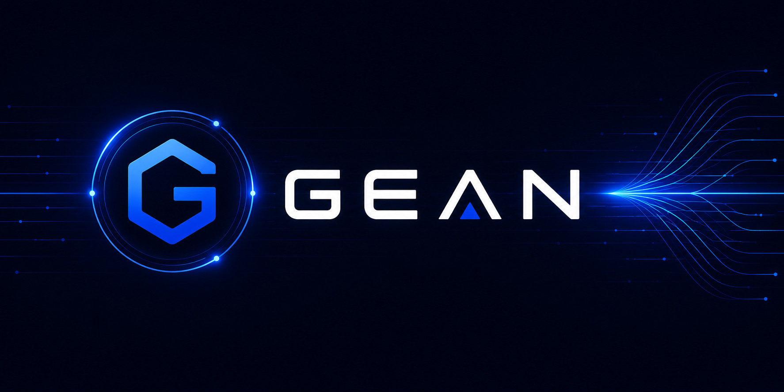

# Gean: Lean Ethereum consensus client

An open-source Lean Ethereum consensus client, written in Go and maintained by Gean Labs.



## Overview

Gean is:

- A consensus client for [Lean Ethereum](https://github.com/leanEthereum), designed for fast finality, quantum-resistant security, and a simpler core protocol.
- Implementing Lean Consensus devnet-5 alongside independent client implementations.
- Built for clarity and auditability, with a deliberately small codebase.
- Quantum-resistant by design, using XMSS signatures instead of BLS signatures.

## Getting started

### Prerequisites

- [Go](https://go.dev/doc/install) 1.26+
- [Rust](https://www.rust-lang.org/tools/install) 1.92.0
- [Docker](https://www.docker.com/get-started/)

### Building and testing

```sh
make build       # Build the Rust FFI and Go binaries
make test        # Run Go unit tests
make test-ffi    # Run XMSS FFI tests
make test-spec   # Download leanSpec's released fixtures and run the spec tests
make lint        # Run Go and Rust linters
make docker-build
```

Run `make help` for all available targets.

### Running locally

For a multi-client devnet:

```sh
make run-devnet
```

For a three-node Gean network, run the setup once and start each node in a separate terminal:

```sh
make run-setup
make run
make run-node1
make run-node2
```

At least one node must run as an aggregator for the network to finalize.

### Memory requirements

Block-proposal and aggregation proofs are generated by the XMSS prover, which
adds a transient multi-gigabyte peak per proof. By default gean proves on the
system allocator, so that scratch is freed after each proof and a long-lived
node's memory stays bounded — this is the mode for packing many nodes onto one
host (interop devnets). `--prover-arena` instead proves on leanVM's bump arena:
faster, but the arena never returns pages, so RSS ratchets to the allocation
high-water mark (~12 GB) and stays there — use it only on a host with memory to
spare where proving latency is the constraint.

Either way, a proof's transient peak is multi-gigabyte; tighter container limits
get the process OOM-killed mid-proving, which is silent in the application log
(check `docker inspect` for `OOMKilled` or the kernel log). The image sets
`GOMEMLIMIT=2GiB` to keep the Go heap out of the prover's headroom; override it
via the environment if your budget differs.

## Current status

Gean tracks Lean Consensus devnet-5. Spec tests run against leanSpec's released
fixtures, pinned by SHA-256 in the [`Makefile`](Makefile) (`make spec-fixtures`
downloads and checks them). Those fixtures still use the earlier Poseidon-line keys
(52 bytes), so state transition, fork choice, signature, proof, sync and API
behaviour is **not yet validated** against the specification: those suites skip,
and CI reports them as a coverage warning. `pinnedFixtureKeySize` in
`lean/spectests/scheme_test.go` records this status. The other suites must pass. The XMSS FFI builds against leanVM
`48a904208d682848dac0e18ef8b01ebfc40df9ad`, the BLAKE2s line: keys and proofs
from the earlier Poseidon line do not verify against it, and validator keys must
come from a keygen built on the same rev.

The leanVM rev is pinned in
[`lean/crypto/xmss/rust/hashsig-glue/Cargo.toml`](lean/crypto/xmss/rust/hashsig-glue/Cargo.toml) and
[`lean/crypto/xmss/rust/multisig-glue/Cargo.toml`](lean/crypto/xmss/rust/multisig-glue/Cargo.toml).

## Architecture overview

Gean is a single Go module organised by protocol. Everything Lean-specific lives under `lean/`: pure consensus rules in `lean/consensus/`, XMSS bindings over Rust FFI crates in `lean/crypto/xmss/`, the node's composition root in `lean/node/`, node services in `lean/internal/`, and spec tests in `lean/spectests/`. Mechanics shared by every protocol live in the root `internal/` and import no protocol types. `beacon/` reserves the Beacon Chain layout: each folder has a README describing what will live there.

| Package | Description |
| --- | --- |
| **Commands** | |
| [`cmd/gean`](cmd/gean) | Flag parsing and signal handling; starts `lean/node` |
| [`cmd/keygen`](cmd/keygen) | Testnet configuration and XMSS key generation |
| **Lean consensus** (pure: no I/O, clock, goroutines or cgo) | |
| [`lean/consensus/types`](lean/consensus/types) | Consensus containers and generated SSZ encoding |
| [`lean/consensus/genesis`](lean/consensus/genesis) | Genesis config, validators, and state |
| [`lean/consensus/statetransition`](lean/consensus/statetransition) | leanSpec state transition: slots, blocks, justification, and finality |
| [`lean/consensus/forkchoice`](lean/consensus/forkchoice) | Proto-array LMD-GHOST, votes, and safe target |
| **Lean cryptography** | |
| [`lean/crypto/xmss`](lean/crypto/xmss) | Go bindings for XMSS keys, signatures, and proofs |
| [`lean/crypto/xmss/rust`](lean/crypto/xmss/rust) | Rust FFI crates: `hashsig-glue` (XMSS), `multisig-glue` (leanVM proofs), and `cgo-glue` (link shim) |
| **Lean node** | |
| [`lean/node`](lean/node) | Builds, runs, and stops the node: bootstrap, store, networking, HTTP servers, and teardown |
| [`lean/internal/chain`](lean/internal/chain) | Engine: single dispatch loop, tick-driven duties, gossip handling, and workers |
| [`lean/internal/chain/blockprocessor`](lean/internal/chain/blockprocessor) | Block validation, verification, transition, and persistence |
| [`lean/internal/chain/attestation`](lean/internal/chain/attestation) | Attestation validation and signature verification |
| [`lean/internal/chain/pending`](lean/internal/chain/pending) | Buffers for blocks and attestations awaiting unknown parents |
| [`lean/internal/validator`](lean/internal/validator) | Attestation production, proposer selection, and the proposal reservation |
| [`lean/internal/validator/dutygate`](lean/internal/validator/dutygate) | Suspends duties while the node lags sync or the network stalls |
| [`lean/internal/store`](lean/internal/store) | Blocks, states, persistence indexes/caches, and database pruning |
| [`lean/internal/pools`](lean/internal/pools) | Bounded, synchronized attestation signatures and new/known payloads; independent of storage and native crypto |
| [`lean/internal/network`](lean/internal/network) | libp2p host, gossipsub topics, req/resp protocols, ENR, and peer dialing |
| [`lean/internal/network/syncer`](lean/internal/network/syncer) | Range sync from peers ahead of the local head |
| [`lean/internal/network/checkpoint`](lean/internal/network/checkpoint) | Checkpoint sync: fetch and verify an anchor state and block |
| [`lean/internal/aggregation`](lean/internal/aggregation) | Signature aggregation into XMSS proofs |
| [`lean/internal/aggregation/role`](lean/internal/aggregation/role) | Runtime aggregator role toggle |
| [`lean/internal/prover`](lean/internal/prover) | Proving gate shared by proposal and aggregation |
| [`lean/internal/prover/shadow`](lean/internal/prover/shadow) | Prover cost model for the Shadow network simulator |
| [`lean/internal/blockbuilder`](lean/internal/blockbuilder) | Block proposal: payload selection and planning |
| [`lean/internal/blockbuilder/attestationproof`](lean/internal/blockbuilder/attestationproof) | Selection and merging of attestation proofs |
| [`lean/internal/api`](lean/internal/api) | HTTP API, admin routes, metrics, pprof, and the Hive test driver |
| [`lean/internal/specfixtures`](lean/internal/specfixtures) | leanSpec fixture parsing |
| [`lean/spectests`](lean/spectests) | leanSpec consensus fixture runners |
| **Shared mechanics** (no protocol types) | |
| [`internal/storage`](internal/storage) | Key-value backends: Pebble, and in-memory for tests |
| [`internal/lifecycle`](internal/lifecycle) | Goroutine groups that shutdown joins before closing storage and keys |
| [`internal/metrics`](internal/metrics) | Prometheus metrics (`lean_` prefix) |
| [`internal/logger`](internal/logger) | Component-scoped logger |
| **Beacon Chain** | |
| [`beacon`](beacon) | Reserved layout, described folder by folder; no code yet |

[docs/architecture.md](docs/architecture.md) describes the layout, its boundary rules, and the remaining work.

## Philosophy

Gean treats reviewability as a consensus-safety property. Consensus-critical behavior should remain small enough to audit end to end, and disagreements between clients should be traceable to a small number of files.

## License

Gean is open-source software released under the MIT license.

## Donations

We are a small team building Gean. Gean is an open-source project and a public good. Funding public goods is hard, and our work is supported through grants, community support, and individual donations.

We work full-time to contribute to the Ethereum ecosystem. If you would like to support our work, you can find our ETH address under **"Sponsor this project"** on this repository.
